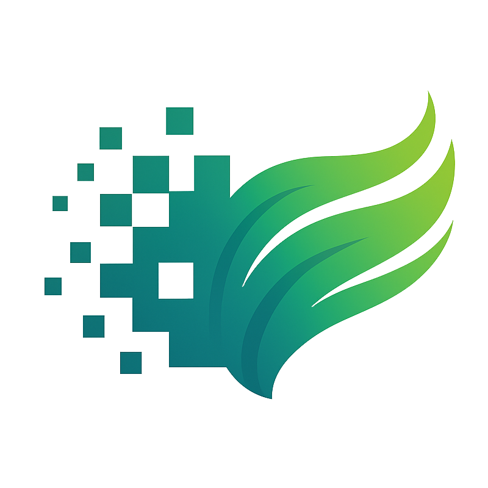
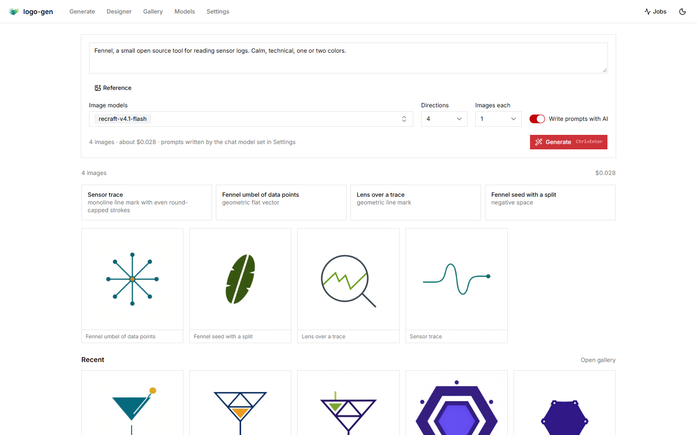
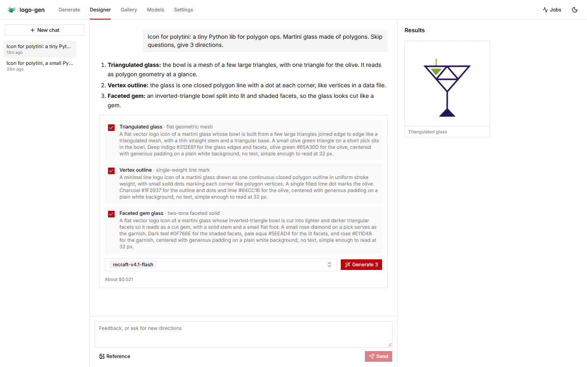
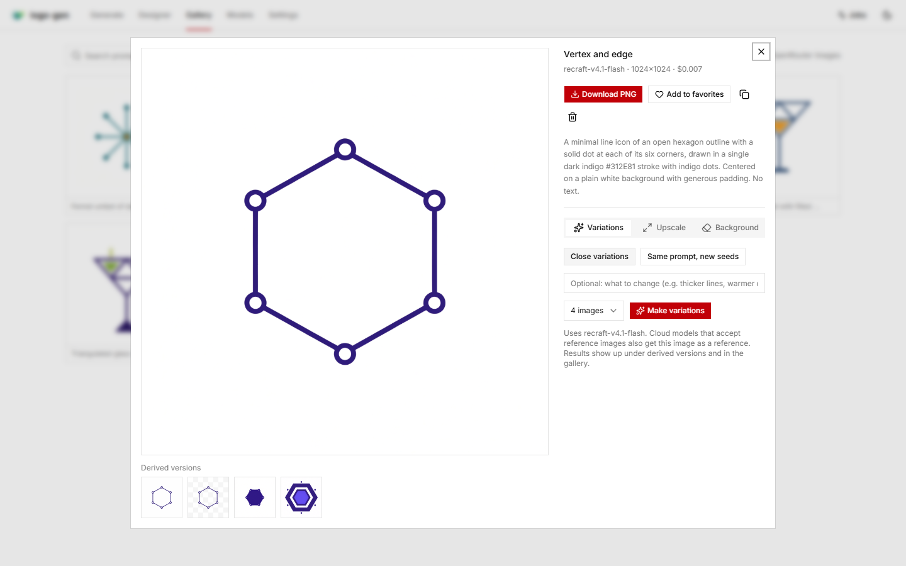
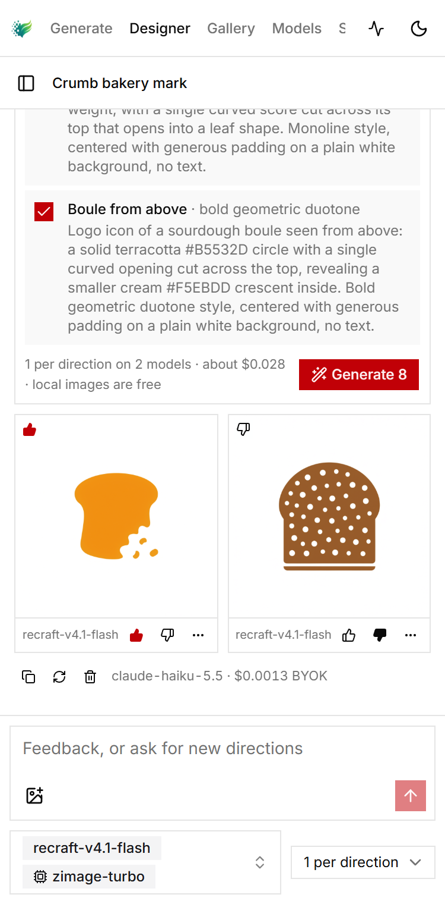
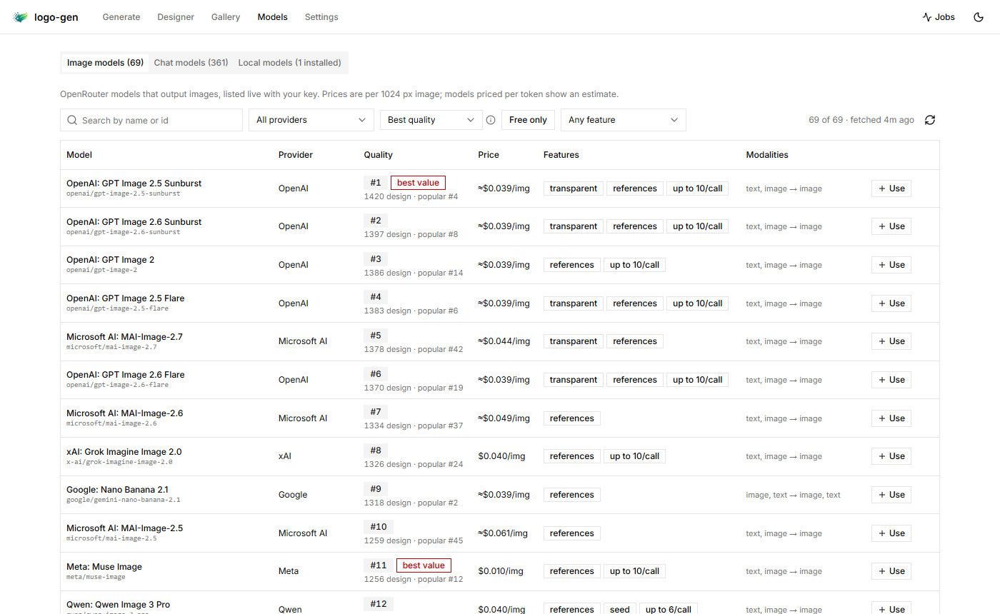
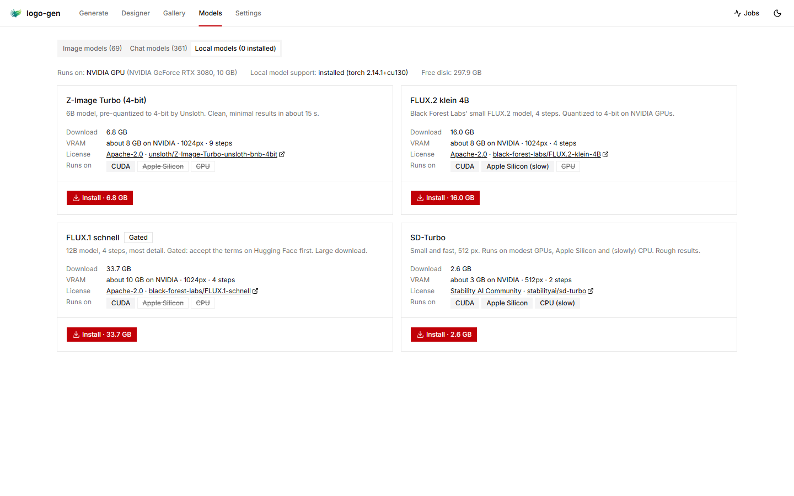

# logo-gen

A local web app for making logo marks and app icons with image models. You describe the thing, a chat model writes a few distinct design briefs, and each image model gets the brief rewritten in the prompt style it reads best. It works with cloud models through OpenRouter and with local models on your own GPU.

I built it because I kept making icons for small projects and got tired of copying prompts between a chat window and an image tool.



## Start

On macOS, Linux or Git Bash:

```sh
./launch.sh
```

On Windows, in PowerShell or `cmd`:

```
.\launch.cmd
```

Or, if you have Node or Bun around, `npm start` or `bun run start` does the same (`npm start -- --port 8000` to pass options). That's the whole setup. It prints one URL, `http://localhost:7860` by default.

Note: the launchers used to be `./logo-gen` and `logo-gen.cmd`. They're `launch.sh` and `launch.cmd` now, and the old names are gone.

The first run takes about a minute. It:

- uses `uv` if it's on your PATH, or downloads it into `.tools/uv` (nothing outside the project folder changes)
- creates `.venv` and installs the Python packages
- installs the frontend packages with `bun` (downloaded into `.tools/bun` if you don't have it) and builds the frontend
- starts the server

A second run checks hashes of `pyproject.toml`, `uv.lock` and the frontend sources, skips everything that didn't change, and has the server answering in 2 to 3 seconds.

Options: `--port 8000`, `--host 0.0.0.0` (it only listens on localhost by default), `--with-local` to install local model support right away, and `--dev` for the Vite dev server with hot reload.

## What's in it

- Generate: type a brief, pick image models, press Generate. The chat model writes 4 directions (different ideas, not the same idea in four colors) and each one is rendered. Images show up as they finish, with a progress bar and a cancel button. Under the progress bar, "Prompts sent" shows exactly what each model got.
- Designer: a chat that asks a few questions (name, what it is, who it's for, mark type, colors, where it's used) or goes straight to directions. You tick the directions you like and the images show up right under that reply. Reference images go to the chat model and to image models that accept them. More on it below.
- Every image keeps the prompt it was made with. Open it to see that prompt, edit it and run the edited version, or look at the design brief behind it.
- Gallery: everything you made, with search and favorites. Each image can be downloaded (PNG, or SVG from vector models), varied, upscaled, or have its background removed. Upscales and background removals don't replace anything. They stay under the original as candidates, so you can try a few methods, compare them side by side or flip between them, and mark the one you want as the version to use. The gallery and the download button then use that version.
- Models: the live OpenRouter catalog split into image models and chat models, with prices, context length, modalities and filters. Also the local models, with install buttons.





## The designer

The designer is a chat, like the usual chat apps, with image generation built in. A few things worth knowing:

- The reply runs on the server, not in your browser tab. You can leave the page, reload, or open the chat in another browser while it's answering, and it picks up where the reply is. Before this, leaving mid-answer lost the reply.
- Each reply's images show up under it, with progress while they render. Rate them with thumbs up or down, or use "Use this direction" to send the image back to the designer with a request to refine it. Variations, a quick 2x upscale, background removal and download are in the same menu.
- You can edit anything you said and send it again. That makes a new branch instead of overwriting, and `< 2 / 2 >` under the message switches between branches. Regenerate works the same way for the last reply. "Delete from here" removes a message and everything after it, with undo.
- The chat list on the left is sorted by last activity, with a thumbnail of the logo you picked (or the newest one), what the chat cost, search, pin and rename (F2). On a phone it's a sheet. `/designer` reopens the chat you had open last, and that's remembered on the server, so it works from any browser.
- The model's thinking is there but collapsed. Click "Thought it through" to read it.



Your reactions (likes, dislikes and picks) are stored with the prompt and model that made each image, and the designer learns from them. More on that in the next section.

## How prompts are written

Image models read prompts very differently. GPT Image follows a labeled spec, Gemini and FLUX want a short paragraph, Recraft wants the style in the prompt and the colors as parameters, and SD-Turbo only reads about 25 keywords. Before this, every model got the same prompt, written for none of them in particular.

So it's two steps now:

1. The designer writes a design brief per direction: mark type, subject in concrete shapes, composition, shape language, palette with hex values, style, background, the exact text (or none) and what to avoid. It doesn't know which model will run it.
2. A renderer turns the brief into a prompt per model, using a profile for that model family in `src/logo_gen/prompting/profiles.py`. The profile says which prompt style to use, how long a prompt the model actually reads, whether it takes a negative prompt, how well it draws text, and which request options help (for example `quality=medium` on GPT Image, the palette as RGB `controls` on Recraft, web grounding off on FLUX 3). Models we don't have a profile for get matched by provider, then fall back to a plain paragraph.

`research/prompting-2026.md` has the per-model notes and sources behind the profiles.

The designer also learns from you. Thumbs up, thumbs down and "Use this direction" update a small profile for the chat: which mark types, styles, shapes, colors and models you reacted to. A pick counts double. When you type feedback like "thicker lines, no gradients", the designer stores those phrases too. It reads a summary before writing new briefs, and visual "less of" phrases like "gradients" go into the image prompts. The brain button in the chat header shows what it learned in that chat, with a button to forget it. Settings shows the profile across chats, and you can turn that part off or clear it.

I compared the old and new prompts on Recraft, FLUX.2 klein, Gemini 2.5 Flash Image and Z-Image Turbo, with contact sheets in `research/eval/`. The new ones follow the requested mark type better (a wordmark stays a wordmark) and stopped hex codes showing up as text. On those four models the old prompts were already decent, though, so don't expect a night and day difference. Z-Image also still fills the frame more than I'd like.

## OpenRouter

Cloud models need an [OpenRouter](https://openrouter.ai) key. Create one at [openrouter.ai/settings/keys](https://openrouter.ai/settings/keys) and paste it into Settings. The app checks it before saving and writes it to `.env` in the project folder, which git ignores. You can also put `OPENROUTER_KEY=sk-or-v1-...` in `.env` yourself.

I'd set a spending limit on the key. Settings shows what the key has spent and how much of its limit is left, and when the limit runs out you get a message saying so, instead of a generic error.

What it costs with the defaults (OpenRouter prices in November 2026; the Models page shows current ones):

- Chat and prompt writing: Claude Haiku 5.5 at `xhigh` reasoning effort, $0.10 / $0.50 per million input / output tokens. A designer reply came to well under a cent in my tests, even with the long thinking.
- Images: Recraft V4.1 Flash, $0.007 per image. A default Generate run is 4 images, so about $0.03.
- Variations of an image: 4 images plus one short chat call, about $0.03.

The Generate page shows an estimate before you press the button. After that, we record what each call actually cost, from the `usage` numbers OpenRouter returns with every response, and keep it in the library database. Each chat shows its running total in the header (designer replies, prompt writing and images), each job shows its own cost, and Settings and the Gallery show the overall total. Local images are listed as free.

One thing that surprised me: if you've added your own provider key to OpenRouter (BYOK, for example an Anthropic key), OpenRouter charges $0 credits for those calls and the provider bills your key instead. The spend lines show that part separately as BYOK, so the total still adds up to what you pay. There are free models too (`:free` in the id), but they share rate limits, and you'll often get "rate limited upstream" during busy hours.

The model list comes from OpenRouter's models API with your key and is cached for 10 minutes. Image models use OpenRouter's Images API, and we only send the options a model supports (seed, count, aspect ratio, transparent background, reference images).



### Which image model is good

Every model picker (Generate, the designer and the Models page) can sort by:

- Best quality: the score on [LMArena's text-to-image leaderboard](https://lmarena.ai/leaderboard/text-to-image). We use its commercial design category, because that's the closest to logos, and the overall score for models that don't have it.
- Best value: quality for the money. The Pareto frontier comes first (models that nothing else beats on both score and price), then the rest. Within each, the score minus 50 points for every doubling of the price per 1024px image above $0.01. So a model that costs twice as much has to score 50 points higher to rank the same. On an Elo scale that's about a 57% chance of winning a head-to-head vote. Free counts as $0.001.
- Cheapest: by the estimated price of one 1024px image. Token-priced models are estimates, marked with "≈".
- Popular on OpenRouter: by image tokens generated over the last 30 days. That's how much a model is used, not how good it is.
- Local / free: installed local models and free OpenRouter models only.

The pickers open with a short "Top picks" list: the best scoring model, the best value, and the ones you used recently. Each model has small badges for its rank, price per image, "best value" if it's on the frontier, "local", or "unranked". The sort you pick is saved.

Where the numbers come from:

- Quality: LMArena publishes its leaderboard as an open dataset on Hugging Face, [`lmarena-ai/leaderboard-dataset`](https://huggingface.co/datasets/lmarena-ai/leaderboard-dataset), under CC BY 4.0. We read it through Hugging Face's public API, with no key, once a day. A dated copy ships in the repo (`src/logo_gen/rankings_snapshot.json`), so it works offline. The current one was published 2026-11-20.
- Popularity: OpenRouter's [rankings API](https://openrouter.ai/docs/api/api-reference/datasets/get-rankings-daily), also CC BY 4.0, with the key you already have.

The UI shows the source, the date and a link wherever a score appears. Leaderboard names don't match OpenRouter ids, so `rankings.py` has an explicit alias table. A model that isn't in it shows as "unranked" instead of being matched by guesswork. Right now 34 of the 69 OpenRouter image models are ranked. Of the local models, Z-Image Turbo and FLUX.2 klein are; FLUX.1 schnell and SD-Turbo aren't on the leaderboard.

I looked at Artificial Analysis' text-to-image arena too. It has an API, but it needs an account and a key, so I went with LMArena's open dataset.

## Local models

Local models are free to run and work offline once installed. Install them from Models, Local models. The first install also adds PyTorch and diffusers to `.venv`. We don't install those up front, so if you only use OpenRouter you never download PyTorch. The launcher picks the build:

- NVIDIA driver with CUDA 13: `cu130` (about 2.5 GB)
- older driver with CUDA 12.6 or newer: `cu126`
- no NVIDIA GPU, or macOS: the CPU build (about 300 MB), which uses Metal on Apple Silicon

| Model | Download | VRAM | License | Runs on |
|---|---|---|---|---|
| Z-Image Turbo (4-bit) | 6.8 GB | about 6 GB | Apache-2.0 | NVIDIA only |
| FLUX.2 klein 4B | 16 GB | about 8 GB | Apache-2.0 | NVIDIA, Apple Silicon (slow) |
| FLUX.1 schnell | 34 GB | about 10 GB | Apache-2.0, gated | NVIDIA only |
| SD-Turbo | 2.6 GB | about 3 GB | Stability AI Community | NVIDIA, Apple Silicon, CPU (slow) |

Weights go to `.models/<model>/`. The download shows progress and speed, can be cancelled, and picks up where it stopped when you press Resume. Uninstall deletes the folder.

FLUX.1 schnell is gated on Hugging Face. Open [its page](https://huggingface.co/black-forest-labs/FLUX.1-schnell), accept the terms while logged in, create a read token at [huggingface.co/settings/tokens](https://huggingface.co/settings/tokens) and paste it into Settings. Until then the install button explains what's missing.

What I've checked on an RTX 3080 (10 GB) on Windows: the install, cancel, resume and uninstall flow (resume continues from the partial file, and the finished file matches the Hub's checksum), and the whole local generation path with a tiny test pipeline, on the GPU and on the CPU. Z-Image Turbo I've run for real: about 30 seconds per 1024 px image after a 30 to 50 second load. I haven't run the other three through this version yet, because each one is a multi-gigabyte download.



## Limits and speed

Settings, Limits and throughput, has caps on how many images one model makes per request: 8 for OpenRouter models and 16 for local ones by default, plus per-model overrides. The image count pickers on the Generate and Designer pages stop at the cap, and the server checks it again, so a request over the cap gets trimmed and the job says so.

OpenRouter requests run 4 in parallel by default. When OpenRouter says to slow down (a 429, or a short-lived in-flight budget limit), we wait for its `Retry-After`, halve the number of parallel requests, and climb back up after a few successes. There's no calibration for cloud models, because that would cost money.

Local models have a Speed test button on the Models page. It loads the model, then tries batch sizes 1, 2, 3, 4 and so on, times each one, and records peak GPU memory. It stops when it runs out of memory, when the next size would need more memory than the card has (peak memory grows about linearly with the batch, so we can predict it), or when bigger batches stop helping. Then you pick an option (fastest overall, or one at a time for the lowest VRAM) and generation batches that way from then on. If a batch still runs out of memory later, we free memory, split the batch in half and retry, down to one image at a time.

On my RTX 3080 (10 GB) with Z-Image Turbo, loading the model takes 30 to 50 seconds and isn't counted. Then:

| Batch | Time | Per image | Peak VRAM |
|---|---|---|---|
| 1 | 29 s | 29 s | 5.9 GB |
| 2 | 53 s | 27 s | 8.7 GB |
| 3 | skipped, would need about 11.6 GB | | |

So batching barely helps on this card: 2 at a time is about 8% faster per image than 1 at a time. Before the speed test learned to skip sizes that don't fit, it ran a batch of 3 anyway. Windows let it spill into system RAM instead of failing, and it took 78 seconds per image. That's why it predicts now. The whole test takes a bit over 2 minutes.

## Without a GPU

Everything except local image generation works without a GPU: OpenRouter chat and images, the gallery, background removal (ONNX on the CPU, about 1 to 2 seconds with ISNet) and Lanczos upscaling. Real-ESRGAN upscaling needs local model support and takes a few minutes per image on a CPU. SD-Turbo is the only local model that runs on a CPU, and the app warns you before installing it.

To try the no-GPU path on a machine that has one:

```sh
LOGO_GEN_DEVICE=cpu ./launch.sh
```

(`CUDA_VISIBLE_DEVICES=` with an empty value does the same.) Apple Silicon should work through Metal for SD-Turbo and FLUX.2 klein, but I haven't tested it on a Mac yet.

## Other chat backends

Settings has two more options for the chat model:

- A local OpenAI-compatible server, such as [Ollama](https://ollama.com), LM Studio or vLLM. Point it at the server URL (Ollama is `http://localhost:11434/v1`) and pick a model. A vision model lets the designer see your reference images.
- The Claude CLI. If you have Claude Code installed and logged in, chats go through `claude -p` on your subscription. It doesn't see reference images.

## Where things are

- `.env`: API keys
- `data/`: settings and the library database (images, chats)
- `output/`: generated, upscaled and cleaned images, plus uploads
- `.models/`: local model weights
- `.tools/`: `uv`, `bun` and launcher state, if the launcher had to download them

All of these are in `.gitignore`. To start over, delete `data/` and `output/`. Spend history lives in `data/` too, so deleting it resets the totals.

The backend is Python (FastAPI, diffusers, rembg) in `src/logo_gen/`. The frontend is React with TanStack Router and Query and shadcn/ui, in `frontend/`. `RESEARCH.md` and `research/` hold the notes I made about models and prompting before writing it. Tests run with `uv run pytest`.

## For AI agents

If an agent is using logo-gen through its API, point it at [llms.txt](llms.txt) (the full API reference is [llms-full.txt](llms-full.txt)). If it's changing the code, [AGENTS.md](AGENTS.md) has the setup, the checks and the rules. Claude Code picks that up through `CLAUDE.md`.

## License

MIT, see [LICENSE](LICENSE).
